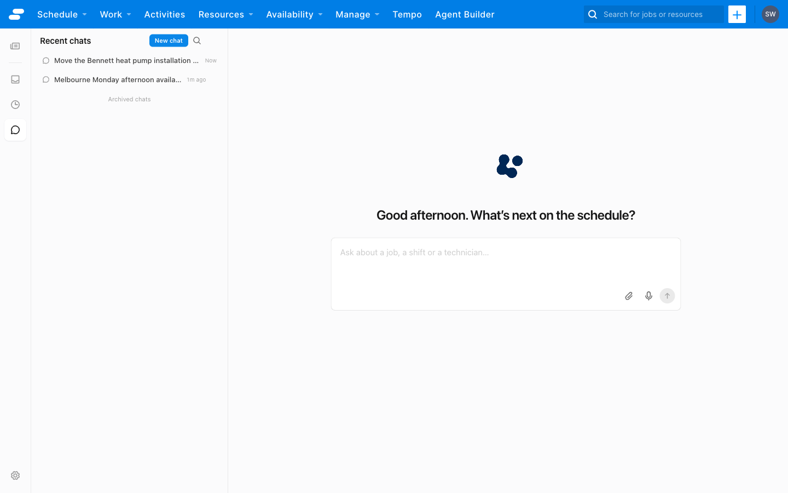
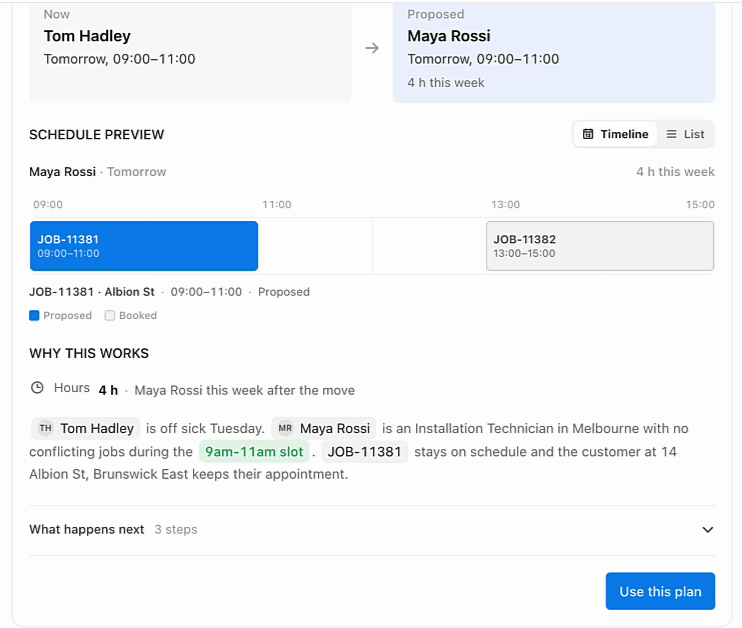
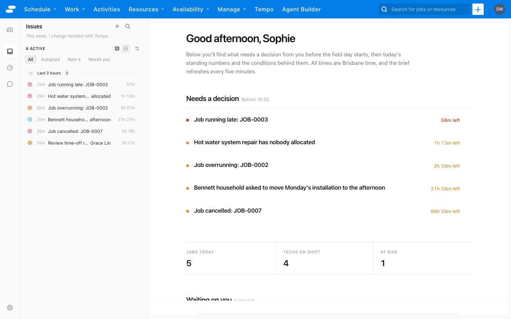

# Skedulo Tempo Agent Examples

A set of example Tempo custom agents, and automations that raise Tempo tasks, to be deployed with the [Skedulo CLI](#usage).

Tempo is Skedulo's AI agent for schedulers. It runs as an inbox of tasks in the Skedulo web app, with a chat alongside. A **custom agent** gives Tempo instructions and a tool allowlist specific to your operation. An **automation** can create a Tempo task when something happens in Skedulo, and ask Tempo to start working on it before a scheduler looks. Both are artifacts, so they live in source control and deploy with the CLI. The [Tempo developer guide](https://docs.skedulo.com/developer-guides/tempo/) explains both in full; the examples here show them in use.

> Tempo is in private beta. Features, limits, and setup steps can change between releases. Contact your Skedulo Customer Success Manager to request access.

## Contributing

We welcome ideas, fixes and new examples! Please see the [CONTRIBUTING](CONTRIBUTING.md) guide here!

## Examples

<table>
<tr>
  <!-- Dispatch Assistant -->
  <td width="50%" valign="top">
    <h2><a href="dispatch-assistant/">Dispatch Assistant</a></h2>
    
    <br/>
    <br/>
    <details>
      <summary><b>ℹ️ More info </b></summary>
      <p>The simplest custom agent, and the one the documentation uses. A <code>scheduler</code> persona with read-mostly tools plus <code>allocate_job</code>, and a boundary that stops it cancelling jobs. Start here.</p>
      <b>Features</b><br/>
      <p>
        <code>Custom agent</code>, <code>scheduler template</code>, <code>negativeBoundaries</code>
      </p>
      <br/><br/>
    </details>
  </td>
  <!-- Sick Leave Cover -->
  <td valign="top">
    <h2><a href="sick-leave-cover/">Sick Leave Cover</a></h2>
    
    <br/>
    <br/>
    <details>
      <summary><b>ℹ️ More info </b></summary>
      <p>An automation that creates and runs a Tempo task the moment a resource records sick leave, so the scheduler opens the inbox to a recommended plan. The README walks through what the scheduler sees.</p>
      <b>Features</b><br/>
      <p>
        <code>Automation</code>, <code>create-tempo-task</code>, <code>run-tempo-task</code>, <code>contextRecords</code>
      </p>
      <br/><br/>
    </details>
  </td>
</tr>
<tr>
  <!-- Customer Cancellation Refill -->
  <td width="50%" valign="top">
    <h2><a href="customer-cancellation-refill/">Customer Cancellation Refill</a></h2>
    
    <br/>
    <br/>
    <details>
      <summary><b>ℹ️ More info </b></summary>
      <p>An automation on a job that a customer cancels. It asks Tempo to fill the freed slot, then branches on the outcome: flag the task for approval when Tempo has a plan, or resolve it when there is nothing to move.</p>
      <b>Features</b><br/>
      <p>
        <code>Automation</code>, <code>update-tempo-task</code>, <code>resolve-tempo-task</code>, <code>Choice step</code>
      </p>
      <br/><br/>
    </details>
  </td>
  <!-- Skedulo API Assistant -->
  <td valign="top">
    <h2><a href="skedulo-api-assistant/">Skedulo API Assistant</a></h2>
    
    <br/>
    <br/>
    <details>
      <summary><b>ℹ️ More info </b></summary>
      <p>A <code>generalist</code> agent that answers reporting questions such as "how many jobs are unallocated per region this week" through the <code>skedulo_api</code> tool, with a scope and boundaries that keep it read-only.</p>
      <b>Features</b><br/>
      <p>
        <code>Custom agent</code>, <code>generalist template</code>, <code>skedulo_api</code>, <code>read-only scope</code>
      </p>
      <br/><br/>
    </details>
  </td>
</tr>
<tr>
  <!-- External API Agent -->
  <td width="50%" valign="top">
    <h2><a href="external-api-agent/">External API Agent</a></h2>
    
    <br/>
    <br/>
    <details>
      <summary><b>ℹ️ More info </b></summary>
      <p>An agent that checks a parts supplier through <code>external_api</code>, restricted by <code>allowedDomains</code>, with the <code>ConfigVariable</code> artifact that holds the supplier's API key. Shows the order the two artifacts deploy in.</p>
      <b>Features</b><br/>
      <p>
        <code>Custom agent</code>, <code>external_api</code>, <code>allowedDomains</code>, <code>ConfigVariable</code>
      </p>
      <br/><br/>
    </details>
  </td>
  <!-- Package -->
  <td valign="top">
    <h2><a href="package/">Package</a></h2>
    <br/>
    <details open>
      <summary><b>ℹ️ More info </b></summary>
      <p>A <code>skeduloPackage.json</code> and <code>src/</code> layout that deploys every example above in one command, with configuration variables, automations, and custom agents in their own folders so that the CLI deploys them in dependency order.</p>
      <b>Features</b><br/>
      <p>
        <code>Package</code>, <code>sked package deploy local</code>, <code>deploy order</code>
      </p>
      <br/><br/>
    </details>
  </td>
</tr>
</table>

## Usage

### Prerequisites

Every example needs:

* A Skedulo Pulse Platform tenant with **Tempo enabled**. See [Enable Tempo in a tenant](https://docs.skedulo.com/developer-guides/tempo/enable-tempo/).
* The [Skedulo CLI](https://docs.skedulo.com/developer-guides/cli/install-the-skedulo-cli/) installed and [authenticated](https://docs.skedulo.com/developer-guides/cli/authenticate-with-the-skedulo-cli/) against that tenant under an alias. The commands below use `<alias>` for it.
* A user with the **Use AI Agent** permission to try the prompts, and the `skedulo.tenant.ai.agent.admin` permission to deploy custom agents.

The automation examples also need the **automations beta** switched on for your team. See [Create Tempo tasks from automations](https://docs.skedulo.com/developer-guides/tempo/create-tasks-from-automations/#before-you-start).

If `sked artifacts custom-agent` or `sked artifacts automation` is missing from your CLI, run `sked artifacts update-descriptors` to refresh the list of artifact types.

### Deploying one example

Each example folder holds its state file(s) and a README with the deploy command, three prompts to try, and what Tempo should do. For example, to deploy the Dispatch Assistant:

```bash
sked artifacts custom-agent upsert -f dispatch-assistant/dispatch-assistant.custom-agent.json -a <alias>
```

To remove it from your tenant:

```bash
sked artifacts custom-agent delete --name dispatch-assistant -a <alias>
```

### Starting a new agent

Copy the [template](template/) folder. Its README has the steps and a checklist of the fields to fill in.

### Deploying everything

The [package](package/) folder deploys all of the examples in one command:

```bash
sked package deploy local -p package -a <alias>
```

### Getting Help

Please see the [Tempo developer guide](https://docs.skedulo.com/developer-guides/tempo/), and if you still experience issues please contact your Customer Success Manager.
