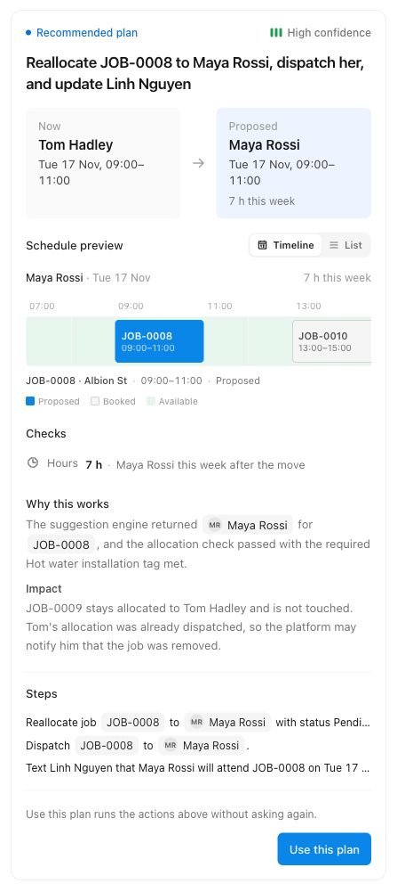

# Sick Leave Cover

An automation that creates a Tempo task the moment a resource records sick leave, attaches the leave and the resource to it, and asks Tempo to start working. By the time a scheduler opens the inbox, Tempo has found the affected jobs and recommended cover.

This is the worked example from [Create Tempo tasks from automations](https://docs.skedulo.com/developer-guides/tempo/create-tasks-from-automations/#example-a-worker-records-sick-leave), as a deployable artifact.

## How it works

| Part | What it does |
| --- | --- |
| Trigger | A **Record modified** trigger on `Availabilities` for the `Insert` operation, filtered to `current.IsAvailable == false AND current.Type == 'Sick'`. |
| `CreateTempoTask` | The `create-tempo-task` action. Builds the title and a description from the leave's `Start` and `Finish`, sets `priority` to `high`, and attaches two `contextRecords`: the availability as the `subject` and the resource as the `actor`. |
| `RunTempoTask` | The `run-tempo-task` action. Takes the task ID from the first step's output, `$createTempoTask.result.data.taskId`, and starts Tempo on it. |

The `Assign` block on each step is what makes the output available to later steps under a variable named after the step. The CLI adds it when it retrieves an automation, so the committed file is exactly what `sked artifacts automation get` returns.

If nothing later in the workflow uses the run's output, you can instead set `autoInvestigate` to `true` in the `CreateTempoTask` arguments and leave out `RunTempoTask`. Keep the separate step when the workflow needs the run's status, as [Customer Cancellation Refill](../customer-cancellation-refill/) does.

## Prerequisites

* Tempo enabled for the tenant, and the automations beta switched on for your team. See [Before you start](https://docs.skedulo.com/developer-guides/tempo/create-tasks-from-automations/#before-you-start).
* The API user that runs automations needs the `skedulo.tenant.ai.agent.automation` permission.
* The Skedulo CLI authenticated against the tenant under an alias (`<alias>` below). If `sked artifacts automation` is missing, run `sked artifacts update-descriptors`.

## Deploy

```bash
sked artifacts automation upsert -f sick-leave-find-cover.automation.json -a <alias>
```

The file sets `status` to `active`, so every deploy activates the automation. Remove `status` from the file if a redeploy should leave an automation that was switched off in the web app as it is.

## Try it

Pick a resource who has a job allocated in the next few days, and record sick leave for them that covers the job:

1. Navigate to **Availability**, select the resource, and add an unavailability of type **Sick** over the job's time.
2. Open the Tempo inbox. A task titled **Sick leave recorded: find cover** is there, at high priority.

### What the scheduler sees

The task opens with the leave record and the resource in its context panel. Tempo has already read the brief, looked up the resource's jobs for the leave period, and proposed a replacement for each one. The run status is **awaiting approval**: the plan is shown as a schedule preview with the reasoning underneath, and nothing has changed in Skedulo yet.



Three things to try in the task's chat:

1. **"Why this person?"**
   Tempo explains the choice: availability in the window, skills, travel, and how the move changes the week's hours.

2. **"Is there anyone closer?"**
   Tempo checks the alternatives and either stands by the plan or revises it. Still nothing has changed.

3. **Click Use this plan.**
   Tempo reallocates the jobs and sends the notifications. The task shows what it did.

## Adapting the trigger

Check the filter against your tenant's data before relying on it:

* If resources request leave for approval, a sick-leave availability can be inserted with `Status` set to `Pending`. Add `AND current.Status == 'Approved'` to the filter so a pending request does not raise a task, and trigger on the `Update` operation with `previous.Status != 'Approved'` for leave that is approved after it is inserted.
* If your tenant uses a different availability type for sick leave, change `current.Type == 'Sick'` to match.

## Remove

```bash
sked artifacts automation delete --name sick-leave-find-cover -a <alias>
```
